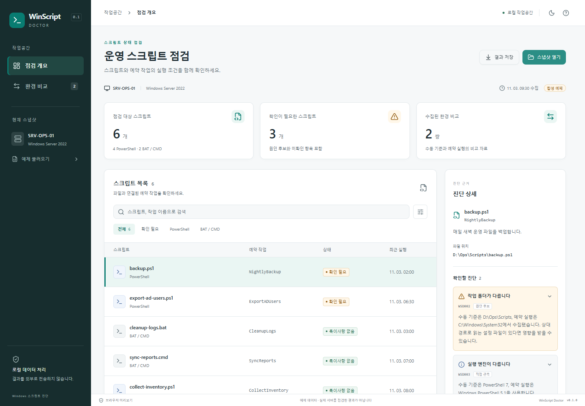

# WinScript Doctor

A desktop prototype for investigating differences between manual and scheduled Windows PowerShell/BAT execution. Built with Go, Wails, React, TypeScript, Tailwind CSS and shadcn/ui.

[한국어 README](README.md) · [Installation](docs/installation.md) · [Roadmap](docs/roadmap.md) · [Contributing](CONTRIBUTING.md)

## Current scope

The app provides an overview and an execution-context comparison screen using synthetic examples or saved JSON snapshots. Search and filters, evidence details, light/dark themes, JSON import/export, strict validation and native file dialogs are implemented. The interface is currently in Korean.

Live Windows collection, scheduled diagnostic probes, call-graph analysis, baseline comparison and HTML reports are planned. This is an early prototype, not a completed operational diagnostic tool. It does not automatically execute business scripts or modify scheduled tasks.

Unlike a job runner, the intended focus is explaining differences in existing Windows automation: account, logon type, engine, architecture, working directory and module search paths. Differences are observations, not proof of a failure's cause; uncollected values remain unknown.



## Platforms

| Platform                          | Package configuration                          | Verification                                       |
| --------------------------------- | ---------------------------------------------- | -------------------------------------------------- |
| Windows amd64                     | Portable ZIP, WebView2 required                | Built and run on Windows 11                        |
| macOS 14+, Apple Silicon / Intel  | ZIP containing an ad-hoc signed .app           | Native build, install and GUI verification pending |
| Linux, Ubuntu 24.04+ / Debian 13+ | .deb and portable tar.gz with a user installer | Native build, install and GUI verification pending |

Linux uses GTK4 and WebKitGTK 6.0. End users do not need Go or Node. macOS public distribution signing and notarization are not implemented. macOS/Linux are intended to inspect saved Windows snapshots; they do not run BAT files or query a local Windows Task Scheduler.

## Build from source

Install Go 1.27.3, Node 24 and the native libraries described in the [installation guide](docs/installation.md). macOS needs Xcode Command Line Tools; Linux needs build-essential, pkg-config, libgtk-4-dev and libwebkitgtk-6.0-dev on Ubuntu 24.04.

```sh
go install github.com/wailsapp/wails/v3/cmd/wails3@v3.1.0
# Ensure the Go bin directory is in PATH.
cd frontend
npm ci
cd ..
```

On Windows, run scripts/build.ps1 or scripts/dev.ps1 from PowerShell. On macOS/Linux:

```sh
sh scripts/build.sh
sh scripts/dev.sh
# Build and package for the current native OS:
sh scripts/package.sh
```

Packages and SHA256 checksums are written to bin/packages. For browser-only development, run npm run dev in frontend. For tests, follow [CONTRIBUTING.md](CONTRIBUTING.md). The manual GitHub Actions workflow builds each OS natively and does not publish releases automatically.

## Data and license

The schemaVersion 1 JSON format is limited to 2 MiB and rejects unknown fields and invalid references. See fixtures/demo-workspace.json for synthetic input. Operational snapshots may contain internal host names, accounts and paths; keep them out of public issues and commits.

Project code is MIT licensed. See [third-party notices](THIRD_PARTY_NOTICES.md) for dependency notices.
