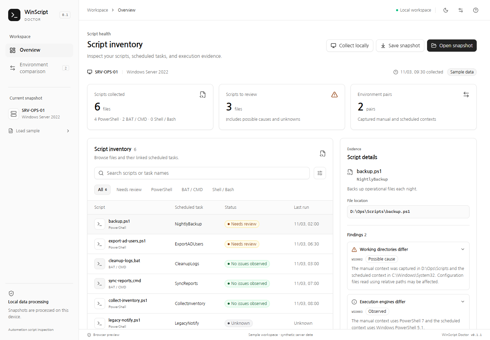

# WinScript Doctor

An early desktop prototype for inspecting Windows PowerShell/BAT snapshots and comparing execution contexts. Built with Go, Wails, React, Tailwind CSS and shadcn/ui. See [English quick start](README.en.md).

Windows 서버의 PowerShell·BAT 스크립트와 예약 작업을 연결하고 실행 환경의 차이를 보여주는 데스크톱 앱입니다. Windows·Linux·macOS용 빌드와 설치 패키지 경로를 제공합니다.

현재 구현은 **Windows 읽기 전용 로컬 수집과 환경 비교 GUI를 제공하는 초기 개발 버전**입니다. 선택한 폴더의 파일과 예약 작업의 명시적인 참조를 수집하거나 저장된 JSON을 탐색합니다. 실제 수동·예약 실행 환경 프로브, 서버 기준본 비교와 HTML 보고서는 후속 단계입니다.

기존 Windows 자동화에서 “수동 실행과 예약 실행의 조건이 왜 다른가”를 설명하는 것이 목표입니다. 현재 수집기는 파일과 저장된 예약 작업 설정을 읽습니다. 실제 실행 환경을 관측하는 프로브와 장애 원인 진단의 완성은 별도 단계입니다.

[다음 개발 순서](docs/roadmap.md) · [기여 안내](CONTRIBUTING.md) · [설치 안내](docs/installation.md)



## 구현된 기능

- 스크립트 검색, 상태·엔진 필터, 선택한 스크립트의 진단 근거 확인
- Windows 폴더 선택 → PS1·BAT·CMD와 SHA-256 수집, 예약 작업 직접 참조와 여러 작업의 연결 보존
- 작업의 실행 파일·계정·로그온 방식·작업 폴더·최근 실행 시각·결과 코드 확인
- 수집 중단과 부분 결과 보존, 링크 제외·권한 부족·변경 중인 파일·용량 제한 표시
- 두 실행 환경의 계정·로그온 방식·엔진·버전·비트 수·폴더·모듈 경로·네트워크 접근 비교
- 차이·미확인 필터, 작업 전환, 좌우 전환, 수집 근거 표시
- 스냅샷 JSON 가져오기·저장과 다시 열기, 잘못된 형식·큰 입력 거부
- 밝은 테마·어두운 테마와 테마 설정 보존, 빈 결과·오류·로딩 상태
- Wails의 WebView2·WebKit 연결 감지와 운영체제의 기본 파일 선택 창 연동

첫 실행의 SRV-OPS-01 및 CONTOSO 계정은 모두 합성 예제입니다. 화면에 예제 여부와 수집 시각을 표시하며, 미확인 항목은 환경 차이 건수에 포함하지 않습니다.

Windows 앱의 **로컬 수집**에서 폴더를 선택합니다. Go에서 작업 스케줄러 COM API를 읽으며 PowerShell 프로세스를 실행하지 않습니다. 기본 제한은 파일 500개, 파일별 해시 16 MiB·전체 256 MiB이며 네트워크 공유와 재분석 지점은 제외합니다. [수집 범위와 스냅샷 형식](docs/collection.md)에 제한과 해석을 정리했습니다.

## 기술과 디자인

Go 1.27.3, Wails 3.1.0, React·TypeScript·Vite, Tailwind CSS, shadcn/ui를 사용합니다. Go 모듈 및 npm 패키지는 잠금 파일로 고정합니다.

기존 `k-style-ui-ux@memorylove-design` 0.17.1의 여정·정보 위계·토큰·상태 색상·한국어 조판 원칙을 데스크톱에 적용했습니다. [디자인 기준](docs/design-system.md)과 [MVP 기획서](docs/MVP.md)를 참고하세요.

## 운영체제별 설치

| 운영체제 | 대상                             | 설치 패키지                         |
| -------- | -------------------------------- | ----------------------------------- |
| Windows  | amd64                            | 포터블 ZIP                          |
| macOS    | 14 이상 Apple Silicon·Intel      | .app이 포함된 ZIP                   |
| Linux    | Ubuntu 24.04 이상·Debian 13 이상 | .deb, tar.gz와 사용자 설치 스크립트 |

[설치와 플랫폼별 빌드 안내](docs/installation.md)를 참고하세요. macOS·Linux에서도 Windows 스냅샷을 열고 환경을 비교하며, 해당 OS에서 BAT 실행이나 Windows 작업 스케줄러 조회를 수행하지 않습니다.

빌드한 Windows amd64 앱은 `bin/WinScriptDoctor.exe`입니다. 실행할 PC에 Microsoft WebView2 Runtime이 필요합니다. PowerShell 7, Go, Node는 **앱 사용자에게 필요하지 않습니다**. 앱은 WebView2를 자동 설치하지 않습니다. [WebView2 공식 배포 안내](https://learn.microsoft.com/en-us/microsoft-edge/webview2/concepts/distribution)

Windows 11에서 실행과 화면 연결을 확인했습니다. macOS·Linux는 연결 코드와 패키지 구조를 보강했으며, 실제 OS에서의 빌드·설치·GUI 검증은 아직 수행하지 않았습니다. Windows Server 및 RDP·각 DPI 조합도 후속 검증 대상입니다.

## 개발

Go 1.27.3, Node 24와 npm, Wails CLI 3.1.0, WebView2를 준비합니다.

```powershell
go install github.com/wailsapp/wails/v3/cmd/wails3@v3.1.0
cd frontend
npm ci
cd ..
.\scripts\dev.ps1
```

이 PC에서 준비한 Go·npm·Wails는 `%LOCALAPPDATA%\WinScriptDoctor\Toolchains`에 있습니다. `scripts/tool-path.ps1`은 해당 경로를 현재 실행 세션에서만 사용합니다. 시스템 PATH·PowerShell 프로필·Git 설정은 변경하지 않습니다.

```powershell
# Windows 실행 파일 생성
.\scripts\build.ps1

# Go·데이터 검증·브라우저 화면 동작 테스트
.\scripts\test.ps1
```

화면만 개발하려면 `frontend`에서 `npm run dev`를 실행합니다. 브라우저 미리보기는 같은 예제와 비교 규칙을 사용하며 실제 Wails 호출과 구분하여 표시합니다. E2E 테스트는 설치된 Microsoft Edge를 사용합니다.

macOS·Linux에서는 네이티브 라이브러리를 준비한 뒤 `sh scripts/build.sh`, `sh scripts/package.sh`, `sh scripts/dev.sh`를 사용합니다. E2E 테스트는 Playwright Chromium을 준비하여 실행합니다. `.github/workflows/desktop-build.yml`은 각 OS에서 네이티브 빌드와 설치 패키지를 생성하는 수동 실행 전용 워크플로입니다. 저장소 공개나 커밋 푸시만으로 워크플로가 실행되지는 않습니다.

## 구조

```text
main.go                 Wails 앱과 창
doctorservice.go        GUI에 공개하는 Go 서비스
internal/doctor/        데이터 모델·스냅샷 검증·환경 비교·테스트
fixtures/               Go와 UI가 공유하는 합성 예제
frontend/src/App.tsx    메인 화면·환경 비교·파일 가져오기
frontend/src/lib/       Wails 어댑터·브라우저 미리보기·검증 테스트
frontend/src/components/ui/  shadcn/ui 컴포넌트
frontend/src/styles.css 디자인 토큰과 데스크톱 레이아웃
frontend/e2e/           실제 브라우저 사용자 흐름 테스트
build/                  Windows manifest·macOS 아이콘과 빌드 설정
scripts/                개발·빌드·테스트 스크립트
docs/                   기획서·디자인 기준·검증 기록
```

## 데이터와 범위

지원 스냅샷은 schemaVersion 1·2, 최대 2 MiB입니다. 기존 v1을 그대로 읽으며 새 수집 결과는 해시·작업 참조·수집 제한이 추가된 v2로 저장합니다. v1만 지원하는 이전 앱은 v2를 열 수 없습니다. 지원하지 않는 필드와 중복 ID·잘못된 참조를 거부하고, 오류에 가져온 원문을 표시하지 않습니다. 실제 자격 증명과 원본 스크립트·전체 명령행을 이 형식에 추가하지 마세요.

비교 자료는 작업명과 스크립트명이 정확히 한 항목을 가리켜야 합니다. 경고 진단이 있으면서 스크립트는 정상으로 기록된 모순된 결과도 거부합니다. 예제 형식은 `fixtures/demo-workspace.json`입니다.

호스트명·계정명·경로는 내부 운영 정보입니다. 내보낸 JSON은 내부용으로 관리하세요. 운영 스냅샷과 WebView2 사용자 폴더는 Git에 넣지 않습니다. 자동 실행, 원격 배포와 비밀번호 저장소는 구현하지 않았습니다.

프로젝트는 MIT 라이선스를 사용합니다. [주요 의존성 고지](THIRD_PARTY_NOTICES.md)를 함께 확인하세요.
