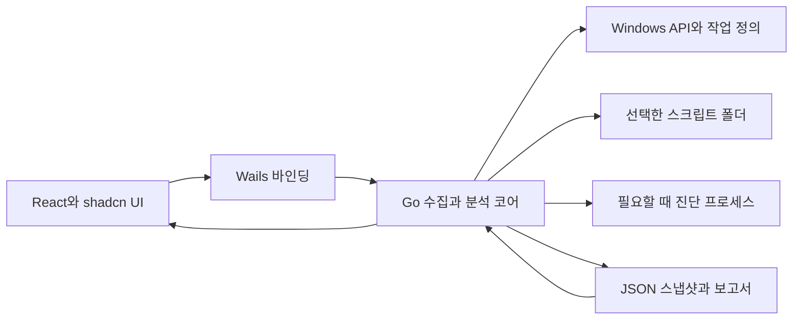

# WinScript Doctor MVP 기획서

작성일 2026년 11월 3일 · 목표 릴리스 v0.1 · 기획 초안

WinScript Doctor는 Windows 서버의 PowerShell과 BAT 자동화를 찾아 연결하고, 실행 환경의 차이와 장애 원인 후보를 근거와 함께 보여주는 Go 기반 데스크톱 앱이다. 첫 버전은 GUI에서 자산 수집, 환경 비교, 서버별 기준본 비교, 보고서 저장까지 수행한다.

대표 사용 사례는 “직접 실행하면 성공하는 스크립트가 예약 작업에서는 왜 실패하는가”이다. Wails와 Go로 데스크톱 앱을 만들고 React·TypeScript·Tailwind CSS·shadcn/ui로 화면을 구성한다. 운영 서버에서 필요할 때 실행한 뒤 종료하는 방식을 기본으로 하며, 디자인 완성도와 전체 프로세스의 자원 사용량을 함께 관리한다.

# 제품 목표와 대상 사용자

Windows 서버에 쌓인 스크립트를 관리하는 운영자가 다음 질문에 답하도록 돕는다.

- 이 스크립트를 호출하는 예약 작업과 다른 스크립트는 무엇인가.

- 수동 실행과 예약 실행에서 계정, 작업 폴더, 실행 엔진과 모듈 경로가 어떻게 다른가.

- 서버별 파일과 실행 설정이 지정한 기준본에서 어떻게 달라졌는가.

- 확인된 사실은 무엇이며, 원인을 좁히기 위해 무엇을 추가로 확인해야 하는가.

초기 대상은 기존 작업 스케줄러와 파일 폴더를 유지하면서 수십 개 이상의 PS1·BAT·CMD를 관리하는 Windows 서버 운영자다. GUI의 기본 작업은 명령줄 입력 없이 완료할 수 있어야 한다. 기존 PowerShell 또는 CMD 세션의 상태를 정확히 수집하는 고급 경로에는 해당 세션에서 실행할 진단 스크립트를 제공한다.

공개 사용자 사례에는 스크립트 70~80개의 버전·예약·재사용 관리가 어렵다는 문제와 수동 실행에서만 인증이 성공하는 문제가 있다. 이는 문제를 뒷받침하는 사례이며 시장 규모를 나타내는 통계는 아니다. [스크립트 관리 사례](https://www.reddit.com/r/PowerShell/comments/1fa94jv/scripts_organization_management_and_scheduling/), [예약 실행 인증 사례](https://www.reddit.com/r/PowerShell/comments/xjugnl/running_powershell_script_with_windows_scheduled/)

# 기존 도구와 차별점

| 비교 대상 | 공식 자료에서 확인되는 중심 기능 | WinScript Doctor가 집중할 가치 |
| --- | --- | --- |
| Rundeck | Windows 노드에 명령과 PowerShell 스크립트 실행 | 서버에 이미 존재하는 작업과 스크립트를 연결하고 실행 조건의 차이를 설명 |
| Semaphore UI | 작업 템플릿, 예약, 실행기와 실행 기록 관리 | 작업을 새 플랫폼으로 이전하기 전에도 현재 실행 환경을 진단 |
| TaskAudit | 예약 작업 실패와 누락 점검, 이전 점검과의 차이 | 스케줄러 상태에 더해 호출된 스크립트와 실행 환경의 관계를 분석 |
| At0mFlow Script Audit | PowerShell 파일과 관련 예약 작업 수집, 파일 해시와 목록 출력 | PS1·BAT·CMD 호출 관계, 실행 환경 비교와 검증 근거를 하나의 GUI에서 연결 |

비교 근거는 [Rundeck Windows 실행 문서](https://docs.rundeck.com/docs/learning/howto/how2winrm-rundeck.html), [Semaphore 구조](https://semaphoreui.com/docs/introduction/architecture), [TaskAudit 저장소](https://github.com/scarja268/TaskAudit), [At0mFlow 도구 설명](https://at0mflow.com/tools)이다. 확장 플러그인과 사용자 스크립트로 유사 기능을 구현할 가능성은 열려 있다.

차별화 가설은 “기존 자산을 그대로 읽고, 실제로 수집한 실행 환경을 비교하며, 각 진단의 근거와 미확인 부분을 보여주면 장애 원인을 찾는 시간이 줄어든다”이다. Go 사용, 단일 실행 파일, 태그, 로그 목록은 구현 선택과 기본 편의 기능이며 독립적인 차별화 근거로 삼지 않는다.

첫 공개 데모에서는 예약 작업 목록 표시보다 수동 실행과 예약 실행의 작업 폴더·엔진·모듈 경로 차이를 발견하는 과정을 앞세운다.

# 첫 버전 기능

| 우선순위 | 기능 | v0.1 범위와 완료 조건 |
| --- | --- | --- |
| 필수 | 스크립트와 작업 수집 | 선택한 로컬 폴더의 PS1·BAT·CMD, 파일 해시, 예약 작업의 실행 파일·인수에서 추출한 안전한 메타데이터·작업 폴더·계정·로그온 방식·최근 실행 결과를 수집 |
| 필수 | 기본 호출 관계 | 예약 작업의 직접 참조, PowerShell의 정적 파일 참조, BAT의 단순 call과 PowerShell 호출을 연결하고 분석 근거 위치를 표시 |
| 필수 | 실행 환경 비교 | 앱이 만든 표준 수동 기준 또는 사용자가 가져온 기존 셸의 수집 결과와, 별도 진단 작업의 수집 결과를 비교 |
| 필수 | 근거 기반 진단 | 진단 항목마다 관측 사실, 원인 후보, 추가 확인 방법, 수집 시각과 정보 출처를 표시 |
| 필수 | 서버별 기준본 비교 | 서버별로 수집해 가져온 스냅샷과 사용자가 선택한 기준본 사이의 파일 해시·엔진·작업 설정 차이를 표시 |
| 필수 | 결과 저장과 다시 열기 | 버전이 있는 JSON 스냅샷을 저장하고 GUI에서 다시 열기. 오프라인 HTML 보고서 내보내기 |
| 필수 | 중단과 부분 결과 | 스캔 취소, 권한 부족, 파일 변경 중 수집, 수집 실패를 구분하고 확보한 결과를 보존 |

기준본은 사용자가 지정한다. 수정 시각만으로 최신본을 판정하지 않으며, 참조를 찾지 못한 파일은 “직접 참조 미발견”으로 표시한다. 이를 미사용 파일로 확정하거나 자동 삭제하지 않는다.

v0.1에서는 전체 드라이브 검색과 원격 수집을 기본 제공하지 않는다. 여러 서버에서 각각 앱을 실행해 만든 결과를 운영자 PC에서 가져와 비교하는 방식으로 시작한다. 네트워크 공유를 직접 순회하거나 원격 호출을 실행하지 않는다.

# GUI와 사용 흐름

주 화면은 왼쪽 탐색 메뉴, 가운데 목록, 오른쪽 상세 패널로 구성한다. 권장 창 크기는 1280×800, 최소 크기는 1024×720을 목표로 한다. 좁은 창에서는 상세 패널을 접고 Sheet로 연다. 키보드 이동, 시스템 글꼴, DPI 배율과 고대비 설정을 지원한다.

| 화면 | 운영자가 하는 일 | 표시할 내용 |
| --- | --- | --- |
| 시작 | 새 점검 또는 저장 결과 열기 | 최근 결과, 선택한 서버 이름과 수집 시각 |
| 자산 | 폴더와 작업 범위 선택 후 스캔 | 스크립트, 연결된 예약 작업, 실행 엔진, 파일 상태 |
| 진단 | 항목 선택과 필터링 | 심각도, 관측 사실, 원인 후보, 확인 방법 |
| 환경 비교 | 수동 기준과 예약 작업의 진단 결과 연결 | 계정, 실행 파일, 버전, 비트 수, 작업 폴더, 모듈 경로와 환경 차이 |
| 서버 비교 | 두 결과 또는 기준본 선택 | 파일과 작업 설정의 추가·삭제·변경 |
| 결과 내보내기 | 저장 위치와 공개 범위 확인 | JSON 저장, HTML 보고서, 개인정보 포함 여부 |

기본 흐름은 새 점검 → 대상 폴더와 예약 작업 선택 → 수집 → 진단 확인 → 필요할 때 환경 비교 → 결과 저장이다. 실행 환경 비교 마법사는 다음 순서로 진행한다.

1. 비교할 예약 작업을 선택하고, 수집된 실행 설정을 보여준다.

2. 수동 기준을 선택한다. 앱에서 새 프로세스로 수집한 기준에는 “새 프로세스 기준”을, 기존 셸에서 수집한 결과에는 “기존 셸에서 수집”을 표시한다.

3. 별도 진단 작업에 사용할 실행 파일과 진단 스크립트, 작업 정의, 등록 안내를 생성한다.

4. 사용자가 Windows 작업 스케줄러에서 별도 작업을 등록하고 필요한 인증을 Windows의 공식 UI에 입력한다. 기존 작업에 저장된 암호를 복사하거나 읽지 않는다.

5. 앱은 등록된 진단 작업의 계정·로그온 방식·권한 수준·작업 폴더·엔진 설정을 원본과 비교한다. 사용자 선택으로 진단 작업만 실행하고 결과를 가져온다.

6. 원본과 다른 설정 또는 재현하지 못한 초기화 과정은 보고서에 표시한다. 원본 업무 스크립트는 실행하지 않는다.

진단용 작업은 고유한 이름과 전용 폴더를 사용하고 자동 반복 트리거를 넣지 않는다. 앱이 관리 대상으로 기록한 진단 작업만 정리할 수 있으며, 원본 작업의 설정과 실행 이력은 변경하지 않는다.

빈 결과, 관리자 권한 없이 일부만 조회된 결과, 엔진 미설치, 정책으로 차단된 진단 스크립트, 예약 실행 시간 초과, 손상된 가져오기 파일을 각각 설명하는 화면을 포함한다.

# 화면 디자인 기준

shadcn/ui의 New York 컴포넌트와 Tailwind CSS의 의미별 테마 토큰을 디자인 기준으로 사용한다. 중립색의 밝은·어두운 화면, 나눔고딕, 키보드 초점과 명확한 상태 레이블을 적용한다. 표시 언어는 영어를 기본으로 하고 설정에서 한국어를 선택한다.

디자인을 시작할 때 아래 두 사용 상황을 기준으로 화면 순서를 정한다.

| 사용 상황 | 앱을 여는 이유 | 첫 화면에서 필요한 정보 | 성공한 순간 |
| --- | --- | --- | --- |
| 장애를 확인하는 운영자 | 예약 작업만 실패하는 원인을 좁히려 함 | 실패한 작업, 호출한 스크립트, 최근 결과와 수집 시각 | 환경 차이와 다음 확인 방법을 찾음 |
| 서버를 인수인계받은 운영자 | 파일과 예약 작업의 관계를 모름 | 자산 목록, 연결 관계, 기준본과의 차이 | 중요한 스크립트의 사용처와 확인할 공백을 파악함 |

도구의 인상은 신뢰·차분·모노를 중심으로 잡는다. 중립적인 바탕에 청록색 주조색을 사용하고 밝은 테마와 어두운 테마를 제공한다. 기존 플러그인 팔레트의 역할 구조를 참고하되 출시 색상은 제품 전용 토큰으로 정하고 대비를 검증한다.

shadcn/ui의 Sidebar·Table·Tabs·Badge·Dialog·Sheet·Progress·Skeleton·Tooltip을 공통 요소로 사용한다. 서버와 수집 시각, 수집 범위는 상단에 두고 검색과 필터는 목록 위에 배치한다. 화면마다 핵심 행동을 하나로 정하고 동일한 목적의 버튼을 중복하지 않는다. 기본 Windows 창 프레임을 유지한다.

색·글자·간격·둥글기는 공통 토큰으로 정의한다. 기존 디자인 원칙의 배경·본문·보조 글자·경계·주조색·경고·실패·완료 역할을 Tailwind CSS 변수와 shadcn/ui 테마 토큰에 대응시킨다. 화면 컴포넌트마다 색을 임의로 정하지 않는다.

| 역할 | 사용할 의미 | 적용 기준 |
| --- | --- | --- |
| 주조색 | 주 행동과 선택 상태 | 버튼·선택 탭·선택 필터에 일관되게 사용 |
| 경고색 | 주의가 필요한 변경이나 위험 | 변경 항목과 조치 우선순위에 사용 |
| 실패색 | 실제 실행 실패 또는 처리 불가 | 추정 원인에 실패색을 사용하지 않음 |
| 완료색 | 완료한 수집과 검증된 처리 결과 | 완료 여부를 텍스트와 함께 표시 |
| 정보색 | 안내와 추가 확인 필요 | 근거 상태와 확인 방법에 사용 |
| 후보 표시 | 확정하지 않은 원인 | 중립적인 외곽선과 “원인 후보” 문구 사용 |

환경 비교 화면은 “항목 · 수동 기준 · 예약 작업 · 판정”의 네 열로 구성한다. 변경된 값만 강조하고 원인 후보를 선택하면 상세 패널에 근거, 확인 방법과 미확인 항목을 보여준다. 파일 경로와 버전은 고정폭 글꼴을 사용하며 긴 값은 복사와 펼치기를 제공한다.

플러그인의 한국어 조판 원칙에 따라 제목은 단어 중간에서 끊지 않는다. 파일 경로·해시처럼 긴 기술 값은 별도 줄바꿈과 복사 규칙을 적용한다. 선 아이콘은 개별 SVG로 사용하고, 운영 진단과 관계없는 사진·일러스트·장식 통계는 넣지 않는다.

디자인 완료 기준은 점검 시작부터 수집 결과·환경 비교·보고서 저장까지 이어지는 전체 흐름과 진행 중·빈 결과·부분 실패·권한 부족·완료 상태를 확인하는 것이다. 100·125·150·200퍼센트 배율, 한글 경로, 긴 작업 이름, 키보드 탐색과 화면 읽기 도구의 기본 레이블도 점검한다.

WebView2가 없어 UI를 열 수 없는 경우에는 부트스트랩 단계의 Windows 기본 대화상자에서 준비 방법을 안내한다. 데스크톱의 높은 정보 밀도는 표와 분할 패널로 처리하고, 짧은 선택·확인은 Dialog 또는 Sheet로 제공한다. 모바일용 하단 탭과 고정 CTA 규격을 데스크톱에 그대로 적용하지 않는다.

# 진단 규칙과 판단 기준

| 규칙 | 확인할 내용 | 판정 시 주의점 |
| --- | --- | --- |
| WSD001 | 실행 파일 또는 정적으로 참조된 스크립트가 보이지 않음 | 수집 계정에서의 관측이며 대상 실행 계정의 접근 권한과 구분 |
| WSD002 | 작업 폴더 차이와 상대 경로 사용 | 상대 경로의 실제 해석을 확인하지 못한 경우 원인 후보로 표시 |
| WSD003 | PowerShell 경로·버전·비트 수 차이 | 차이 자체는 관측 사실이며 장애와의 인과관계는 별도 확인 |
| WSD004 | 모듈 검색 경로와 명시된 의존성 차이 | 모듈 목록을 확인하고 자동 Import로 부작용을 만들지 않음 |
| WSD005 | 실행 계정·로그온 방식·권한 수준 차이 | 비밀번호 만료나 실제 파일 권한을 설정만으로 확정하지 않음 |
| WSD006 | PowerShell 5.1과 비ASCII 소스의 인코딩 위험 | 코드 페이지와 파일 바이트를 근거로 호환성 후보를 표시 |
| WSD007 | S4U 로그온과 네트워크 자원 참조 | 로그온 방식의 제한을 설명하고 별도 인증 여부는 미확인으로 남김 |
| WSD008 | 기준본과 스크립트 또는 작업 설정 불일치 | 기준본이 없는 상태에서는 어느 쪽이 올바른지 판정하지 않음 |

예약 작업의 작업 폴더를 지정하지 않았을 때 기본 위치가 system32라는 동작은 [Microsoft 작업 실행 문서](https://learn.microsoft.com/en-us/powershell/module/scheduledtasks/new-scheduledtaskaction?view=windowsserver2025-ps)에 근거한다. PowerShell 5.1의 BOM과 ANSI 해석 차이는 [문자 인코딩 문서](https://learn.microsoft.com/en-us/powershell/module/microsoft.powershell.core/about/about_character_encoding?view=powershell-7.6)에 근거한다. S4U 로그온의 네트워크 및 암호화 파일 접근 제한은 [작업 로그온 방식 문서](https://learn.microsoft.com/en-us/windows/win32/api/taskschd/ne-taskschd-task_logon_type)에 근거한다.

화면에서는 심각도와 근거 상태를 별도로 표시한다. 근거 상태는 “직접 관측”, “원인 후보”, “미확인”, “해당 없음”으로 구분한다. 심각도는 조치 우선순위를 나타내며 원인이 확정되었다는 뜻으로 사용하지 않는다.

동적으로 조합된 경로, 복잡한 BAT 변수 확장, PowerShell 동적 실행, 프로필에서 주입한 함수, 스크립트 실행 중 변경되는 환경은 v0.1에서 완전하게 추적하지 않는다. 확인 가능한 참조만 연결하고 나머지는 분석 제한으로 표시한다.

# 기술 스택

| 영역 | 선택 | 선택 이유 |
| --- | --- | --- |
| 앱과 진단 코어 | Go의 착수 시점 지원 중인 안정 버전 | Windows 연동, 분석과 데이터 관리를 담당하며 코어를 UI와 분리 |
| 데스크톱 프레임워크 | Wails v3 안정 릴리스 계열 | Go 서비스와 웹 UI를 연결하고 Windows WebView2를 사용 |
| 화면 | React와 TypeScript | 표·비교 패널·마법사의 상태를 명확하게 관리 |
| UI 빌드 | Vite | 프런트엔드 개발과 프로덕션 정적 자산 빌드 |
| 스타일 | Tailwind CSS | 필요한 스타일을 빌드 결과에 포함하고 디자인 토큰으로 일관성 유지 |
| 컴포넌트 | shadcn/ui의 필요한 컴포넌트만 도입 | Button·Table·Dialog·Sheet·Tabs·Badge·Progress 등을 공통 디자인으로 구성 |
| 아이콘과 표 | Lucide의 개별 아이콘과 페이지 단위 표 | 아이콘 전체 묶음과 무거운 그리드 도입을 피하고 필요하면 가상화 추가 |
| Windows 연동 | golang.org/x/sys/windows와 Task Scheduler COM API | 작업 정의와 Windows 상태를 조회하고 전용 진단 작업을 식별 |
| PowerShell 보조 | 설치된 Windows PowerShell 5.1 또는 PowerShell 7 | 선택한 엔진의 AST와 실행 정보 수집. PowerShell 7 설치를 요구하지 않음 |
| BAT 분석 | Go 기반 제한된 정적 분석 | 단순 호출과 경로만 처리하고 CMD 코드를 평가하지 않음 |
| 데이터와 보고서 | encoding/json과 html/template | 별도 DB 없이 스냅샷과 오프라인 HTML 생성 |
| 테스트 | Go testing, 프런트엔드 컴포넌트 테스트와 Windows VM 통합 테스트 | 규칙·상태 화면·Windows 실행 환경과 실제 데스크톱 동작 검증 |
| 배포 | Windows amd64 포터블 ZIP | 실행 파일, 라이선스 고지, 사용 안내와 별도 WebView2 준비 절차 제공 |

Wails 공식 문서는 v3 안정 릴리스와 Windows WebView2 의존성을 설명한다. Wails와 Go·Node의 정확한 버전은 착수 시 공식 요구사항을 확인해 고정한다. [Wails 프로젝트 상태](https://wails.io/status/), [Wails 공식 설명](https://wails.io/faq/)

Tailwind와 shadcn/ui는 Vite 기반 프런트엔드에 구성하고, 설치한 컴포넌트와 직접 의존하는 패키지를 잠금 파일로 관리한다. Node와 프런트엔드 빌드 도구는 개발 환경에만 필요하고 사용자 PC에서는 실행 파일과 WebView2로 앱을 실행한다. [Tailwind Vite 구성](https://tailwindcss.com/docs/installation/using-vite), [shadcn/ui Vite 구성](https://ui.shadcn.com/docs/installation/vite)

Windows에서는 설치된 Evergreen WebView2 Runtime을 우선 사용한다. 미설치 서버에는 Microsoft의 공식 온라인 설치 또는 별도 오프라인 설치 절차를 안내하고 앱이 자동 설치하지 않는다. 앱 ZIP 크기와 WebView2 추가 설치 용량은 구분해 기록한다. WebView2 준비 후 기본 점검은 인터넷 연결 없이 동작해야 한다. [Microsoft 배포 문서](https://learn.microsoft.com/en-us/microsoft-edge/webview2/concepts/distribution)

초기 GUI 지원 목표는 Windows 11과 Windows Server 2019·2022·2025의 Desktop Experience, amd64다. 이 목록은 검증 대상이며 Wails·WebView2·Windows API 통합 테스트를 통과한 조합만 지원으로 표시한다. Server Core GUI와 ARM64는 v0.1 범위 밖으로 두고 이후 별도 수집기를 검토한다.

# 구조와 데이터

코어는 GUI 상태에 의존하지 않는다. 수집, 파일 분석, 환경 비교, 진단 규칙, 저장 기능을 분리한다. 스냅샷만으로 진단과 보고서를 다시 생성할 수 있어야 하며, GUI가 닫히면 앱이 시작한 진단 프로세스의 정리 여부를 확인한다.

최소 데이터는 Snapshot, Script, Task, Context, Relation, Finding으로 구성한다. 스냅샷에는 schemaVersion, 앱 버전, 수집 시각, 호스트 식별자, 수집 권한 범위와 부분 실패를 기록한다. Context에는 “앱의 새 프로세스”, “기존 셸”, “진단 예약 작업” 중 어떤 방식으로 얻었는지와 실제 관측 시각을 포함한다.

참조 관계에는 파일 경로와 줄 번호 등 근거를 연결한다. Finding에는 규칙 ID, 관측 사실, 원인 후보, 미확인 항목과 다음 확인 방법을 저장한다. 서로 다른 서버의 스크립트는 사용자가 선택한 폴더 대응 관계 또는 명시한 식별자로 비교하며 파일 이름만 같은 항목을 자동으로 동일 자산으로 확정하지 않는다.

대량 데이터의 원본은 Go에서 보관한다. 프런트엔드에는 현재 화면의 요약과 페이지 단위 데이터만 전달하고 동일한 전체 목록을 반복 직렬화하지 않는다. 필터와 정렬은 코어에 요청하며 UI에는 선택 항목과 표시 상태를 보관한다. 스캔 진행 이벤트는 최대 초당 10회로 묶어 전달한다.

파일 읽기와 해시는 스트리밍 방식으로 처리하고 정션과 심볼릭 링크는 기본적으로 따라가지 않는다. 진단 프로세스는 한 번에 하나만 실행하고 시간 제한과 취소를 지원한다. 프런트엔드에는 고정된 업무 기능만 바인딩하며 임의 PowerShell 명령이나 쉘 실행 기능을 노출하지 않는다.

# 경량화 목표와 측정 방법

아래 수치는 개발 목표다. 실제 공개 수치는 릴리스 빌드로 측정한 결과를 사용한다. Go 사용이나 실행 파일 크기만으로 경량화를 달성했다고 판단하지 않는다.

| 항목 | v0.1 목표 | 측정 조건 |
| --- | --- | --- |
| 앱 실행 파일 크기 | 25 MiB 이하 | 빌드된 UI와 진단 보조 파일 포함. WebView2 Runtime 제외 |
| 앱 배포 ZIP | 30 MiB 이하 | 라이선스와 사용 안내 포함. WebView2 추가 설치분은 별도 기록 |
| 프런트엔드 JS와 CSS | 합계 gzip 400 KiB 이하 | 디버그 소스맵을 제외한 프로덕션 자산의 참고 지표 |
| 시작 시간 | 3초 이내 | WebView2 준비 상태에서 창 표시 후 입력을 받기까지 |
| 대기 메모리 | 합계 Private Bytes 180 MiB 이하 | 앱 전용 Go·WebView2 프로세스 합계. 1천 개 자산 로드 후 60초 대기 |
| 수집 중 메모리 | 합계 Private Bytes 350 MiB 이하 | 앱 전용 Go·WebView2 프로세스 합계의 최대값 |
| 진단 실행 중 메모리 | 합계 Private Bytes 600 MiB 이하 | 앱 전용 Go·WebView2와 진단 보조 프로세스의 같은 시점 합계 최대값 |
| 대기 CPU | 전체 CPU 용량 대비 평균 0.5퍼센트 이하 | 앱 전용 프로세스 합계. 사용자 입력 없이 60초 관측 |
| 자산 수집 시간 | 30초 이내 | 로컬 SSD의 작업 200개, 파일 1천 개·총 50 MiB인 합성 데이터 |

기준 장비는 4 vCPU, RAM 8 GiB, SSD를 사용하는 Windows Server 2022 Desktop Experience VM으로 잡는다. OS 빌드, 보안 소프트웨어, Go와 Wails·WebView2 버전을 기록하고 10회 측정의 중앙값과 최댓값을 보고한다. 시작 시간은 최초 실행과 이후 실행을 구분한다.

WebView2가 없는 PC의 추가 설치 시간·용량은 기본 성능표와 별도 항목으로 공개한다. 프런트엔드 gzip 수치는 번들 크기를 비교하기 위한 지표이며 실행 파일 안의 실제 자산 크기와 동일하지 않다.

상주 서비스, 자동 시작, 주기적 전체 스캔, 자동 네트워크 통신은 기본 동작에 넣지 않는다. 단일 창을 사용하고 표는 페이지 단위로 표시한다. 모든 컴포넌트·아이콘을 한꺼번에 가져오지 않으며 웹폰트·CDN·원격 이미지를 사용하지 않는다.

v0.1에는 Monaco Editor, 대형 그래프·차트 라이브러리와 무거운 애니메이션 프레임워크를 도입하지 않는다. 코드 근거는 줄 번호가 있는 읽기 전용 텍스트로, 호출 관계는 펼칠 수 있는 트리로 보여준다. Tailwind는 빌드 시 CSS를 생성하고 shadcn/ui는 사용하는 구성 요소만 포함한다.

메모리 목표를 넘으면 프로세스 동시 실행 수, JSON 중복 보관, 전체 파일 적재와 React 재렌더링을 먼저 조정한다. PowerShell 분석은 가능한 범위에서 배치 처리한다. WebView2와 보조 PowerShell의 자원 비용을 앱 메모리에서 숨기지 않는다.

# 운영 데이터와 실행 경계

스크립트와 작업 설정은 읽어서 분석하되 업무 스크립트를 자동 실행하거나 수정하지 않는다. 일반 수집은 현재 사용자의 권한으로 수행하며 조회하지 못한 항목을 부분 결과로 표시한다. 더 높은 권한이 필요한 조회와 진단 작업 실행은 GUI에서 별도 동작으로 구분한다.

저장 데이터는 허용 목록으로 구성한다. 소스 전체, 원본 작업 XML, 전체 명령행 인수와 환경 변수 전체를 기본 저장하지 않는다. 실행 엔진 경로, 해석된 스크립트 경로와 필요한 설정만 추출하고 나머지 인수는 값 대신 생략 표시를 사용한다. 환경 변수는 PATH와 PSModulePath 등 진단에 필요한 이름을 명시적으로 선택하며, 기본 목록 밖의 값은 수집하지 않는다.

인증정보, 실제 .env, 인증서 개인키와 비밀번호 저장소를 읽거나 내보내지 않는다. 프로필 코드를 임의로 실행하거나 PowerShell 실행 정책을 자동 변경하지 않는다. 정책이 진단 스크립트를 차단하면 조직의 서명 절차를 안내하고 수집 실패 상태를 남긴다. [PowerShell 실행 정책](https://learn.microsoft.com/en-us/powershell/module/microsoft.powershell.core/about/about_execution_policies?view=powershell-7.6)

호스트명, 계정명, 경로 자체도 운영 정보이므로 로컬 결과는 내부용으로 취급한다. 공개 이슈용 내보내기는 가명화한 메타데이터와 사용자가 미리 본 선택 항목만 포함한다. 샘플과 테스트는 합성 데이터만 사용한다.

스냅샷 가져오기와 HTML 내보내기에서는 크기·깊이·경로를 검증한다. 스크립트 내용과 파일명은 실행 가능한 코드나 원시 HTML로 사용하지 않는다. PowerShell 보조 프로세스에는 고정된 진단 코드와 구조화된 입력만 전달하고 수집한 문자열로 실행 명령을 조립하지 않는다.

기존 예약 작업의 과거 stdout·stderr가 저장되어 있지 않으면 복원할 수 없다. v0.1은 확인 가능한 작업 결과와 사용자가 가져온 진단 기록을 보여주며, 업무 스크립트의 상시 로그 수집은 후속 범위로 둔다.

Wails UI는 로컬로 포함된 자산만 로드하고 외부 탐색과 원격 콘텐츠 로딩을 차단한다. 릴리스 빌드에서는 개발 서버를 사용하지 않는다. WebView2 사용자 데이터 폴더와 운영 스냅샷은 공개 저장소에 포함하지 않는다.

# 개발 순서와 단계별 완료 기준

전담 개발자 1명과 테스트 VM 확보를 가정해 6주 베타 구현과 최대 2주의 호환성·사용자 피드백 반영 기간을 잡는다. 앞 단계의 기술 검증을 통과한 뒤 다음 단계로 진행한다.

| 단계 | 예상 기간 | 구현 순서와 산출물 | 다음 단계 진입 기준 |
| --- | --- | --- | --- |
| 기술 검증 | 1주차 전반 | Wails와 Go, React·Tailwind·shadcn/ui 기본 창, 표·트리, Windows 작업 조회, 별도 진단 작업에서 계정·폴더·엔진 수집 | 대상 VM에서 GUI와 환경 비교가 동작하고 초기 용량·메모리 측정 완료 |
| 데이터 계약과 수집 | 1주차 후반에서 2주차 | JSON 스키마, 파일·작업 수집, 부분 실패, 기본 호출 관계와 합성 재현 데이터 | 저장 후 다시 열었을 때 관측값과 수집 범위 보존 |
| 환경 비교 | 3주차 | GUI 마법사, 수동 기준 수집, 진단 작업 설정 검증, 결과 연결과 취소 | 원본 작업을 변경하지 않고 수동·예약 환경 차이 표시 |
| 진단과 기준본 비교 | 4주차 | WSD001부터 WSD008, 원인 후보 표시, 파일과 작업 설정 비교 | 재현 사례에서 기대한 진단과 미확인 판정이 일치 |
| GUI와 경량화 검증 | 5주차 | shadcn/ui·Tailwind 토큰 검토, 검색·필터, 상태 화면, HTML 내보내기, DPI·한글·RDP, 메모리 개선 | 핵심 GUI 흐름과 자원 목표를 기준 환경에서 검증 |
| 사용자 검증과 공개 준비 | 6주차 | 운영자 사용성 점검, 재현 예제, README, 라이선스, 릴리스 ZIP 초안 | 아래 공개 기준을 충족하고 실제 한계를 문서화 |

기술 검증 단계에서 대상 계정의 진단 결과를 신뢰할 수 있게 얻지 못하면 해당 수집 경로를 먼저 해결한다. 보고서와 화면 꾸미기로 환경 비교 기능의 공백을 대신하지 않는다.

저장소 구조는 cmd/winscript-doctor, internal/core, internal/windows, internal/analyzers, internal/rules, internal/report, frontend/src/components, frontend/src/features, probes, testdata, docs로 시작한다. 공개 API와 플러그인 규약은 실제 확장 수요가 생긴 뒤 정한다.

# 첫 공개 버전의 검증 기준

기능 검증에서는 다음 사례를 재현한다.

- 상대 경로를 사용하는 스크립트에서 수동 기준과 예약 작업의 작업 폴더 차이를 보여준다.

- powershell.exe와 pwsh.exe의 버전 또는 비트 수 차이를 보여준다.

- 계정별 PSModulePath 차이를 표시하고 모듈 Import 성공 여부를 임의로 확정하지 않는다.

- BAT에서 PowerShell을 호출하는 단순 연결을 보여주고 동적 경로는 미확인으로 남긴다.

- S4U와 네트워크 자원 참조를 발견하되 실제 접근 결과로 오인하지 않는다.

- 기준본과 서버별 해시·작업 설정의 차이를 찾아낸다.

- 파일 없음, 권한 부족, 프로브 시간 초과, 수집 취소, 읽는 중 파일 변경을 구분한다.

- 비밀번호와 토큰을 심은 합성 입력이 기본 JSON·HTML·진단 로그에 남지 않는다.

- 수집 전후 원본 예약 작업 정의와 스크립트 해시가 동일하다.

- PowerShell 7 미설치 환경과 인터넷 차단 환경에서 기본 GUI 점검과 저장 결과 열기가 동작한다.

지원 표시 전 Windows Server 2019·2022·2025 Desktop Experience와 Windows 11의 목표 조합을 검증한다. 확보하지 못한 OS나 셸 조합은 미검증으로 남긴다. 성능은 앞의 기준 VM과 합성 데이터로 측정한다.

사용자 검증 목표는 운영자 5명이 합성 또는 익명화 사례로 사용해 보는 것이다. 자산 수집과 결과 열기는 명령줄 도움 없이 4명 이상이 완료하고, 환경 비교는 추가 설명이 필요한 지점을 기록한다. 원인 후보를 좁히는 시간은 기존 방식과 같은 사례로 비교하여 중앙값 30퍼센트 단축을 목표로 한다. 이 수치는 출시 전 검증할 목표이며 달성 결과가 아니다.

공개 준비물은 포터블 ZIP, 한국어·영어 README, 3개의 재현 예제, 지원 환경표, JSON 스키마, 개인정보 처리 설명, 테스트 결과와 자원 측정표다. 프로젝트 자체 코드는 MIT 라이선스를 기본안으로 하고 의존성 라이선스와 저작권 고지를 함께 제공한다. 실제 운영 자료는 포함하지 않는다.

# 후속 개발 범위

| 버전 | 확장 후보 | 착수 조건 |
| --- | --- | --- |
| v0.2 | 더 깊은 호출 관계와 파일 변경 영향, 담당자·용도 메모 | 정적 분석 범위와 오탐 사례를 운영자 피드백으로 확인 |
| v0.3 | 선택한 서버의 원격 수집과 결과 모으기 | 권한·인증·전송 정책을 정하고 로컬 수집의 유용성을 검증 |
| 이후 | 실행 기록 수집, Rundeck와 Semaphore 연동, Server Core 수집기 | 기존 실행 도구와 함께 사용하는 수요가 확인됨 |

자체 스케줄러, 비밀번호 보관소, 자동 수정, 전체 서버 배포, 업무 스크립트의 자동 재실행, AI 원인 판정은 v0.1에서 제외한다.

첫 공개 화면과 README는 “수동 실행에서는 되는데 예약 실행에서는 실패하는 스크립트의 환경 차이를 GUI로 비교한다”는 사용 사례에 집중한다.
