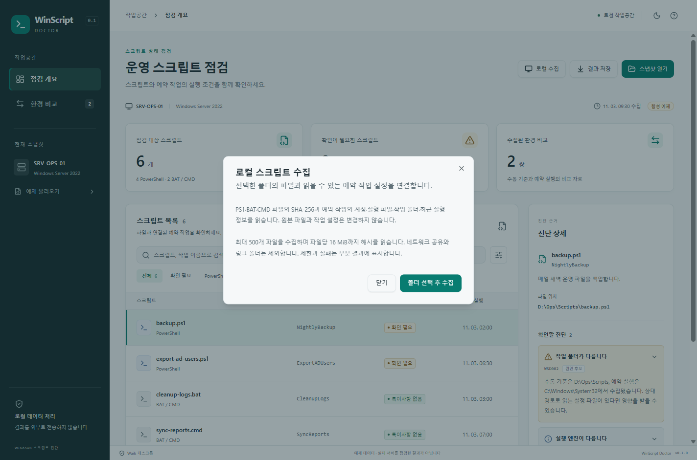

# 읽기 전용 수집 검증

2026년 11월 3일 현재 PC의 Windows 11에서 검증했습니다. 이전 화면·공개 준비의 기록은 [verification.md](verification.md)에 보존합니다.

| 항목                | 결과                                                                                                                              |
| ------------------- | --------------------------------------------------------------------------------------------------------------------------------- |
| Go 테스트           | go test ./... 통과. 파일 해시·원본 보존·변경 중인 파일·참조 해석·부분 결과·취소·2 MiB 제한·v1/v2 계약 확인                        |
| 프런트엔드          | Vitest 51개 통과. 새 수집 상태, 취소·선택 취소·실패 시 이전 결과 보존, 오류 상세 비노출 포함                                      |
| 사용자 흐름         | Edge Playwright 10개 통과. 수집 불가 환경 안내, 부분 결과·여러 작업 참조·추가 작업명 검색·최소 창 크기 포함                       |
| 패키징              | Node 테스트 5개 통과, Windows 프로덕션 실행 파일·ZIP·SHA256 생성                                                                  |
| 실제 작업 조회      | 현재 계정의 예약 작업 188개, 실행 동작 76개 조회. 이 조회의 부분 실패 없음                                                        |
| 실제 수집 진입점    | 임시 합성 PS1 한 개의 해시와 같은 PC의 작업 188개를 수집. 동적 호출 등 지원 범위 밖의 동작은 부분 결과로 기록                     |
| Wails 연결          | 실제 WebView2에서 GetCapabilities의 수집 허용, v2 파싱과 작업 참조 2개, 유휴 상태 취소 false 확인. 페이지 오류 0개                |
| 비Windows 코드 경로 | collector 코어 테스트 바이너리를 Linux amd64·Darwin arm64 대상으로 크로스 컴파일. 해당 OS에서 실행하거나 GUI를 빌드한 검증은 아님 |
| 실행 파일           | 11,142,656 bytes, 약 10.63 MiB. 이전 빌드보다 144 KiB 증가                                                                        |
| 프런트엔드          | JS 합계 gzip 약 130.80 kB, CSS gzip 약 10.23 kB                                                                                   |

네이티브 조회는 원본 파일 쓰기나 작업 등록·실행·삭제를 하지 않았습니다. 원본 스크립트와 작업의 실제 업무를 실행하는 테스트도 하지 않았습니다. 실제 계정·호스트·경로·작업 인수·작업명은 테스트 로그와 공개 자료에 기록하지 않고 건수만 남겼습니다. 공개 fixtures와 화면 캡처는 합성 자료입니다.

## 확인 범위의 한계

네이티브 파일 선택 창에서 폴더를 직접 선택하는 전체 GUI 흐름은 이번 자동 검사에서 수행하지 않았습니다. 수집 함수는 실제 COM으로, 수집·취소 화면 흐름은 서비스 응답을 모사해 각각 검증했습니다. 개별 COM 호출을 강제 중단하는 기능은 없습니다. 취소와 시간 제한은 읽기 사이에 적용됩니다.

Windows Server·RDP·DPI와 제한된 계정의 다양한 ACL 조합은 미검증입니다. Mac·Linux에서는 로컬 수집을 지원하지 않습니다. 이후에 진행한 Mac·Linux 네이티브 패키지 검증은 [배포 검증](release-verification.md)을 참고하세요. 전체 프로세스 메모리·CPU와 시작 시간은 측정하지 않았습니다. 파일 크기를 메모리 사용량으로 해석하지 않습니다.

실제 수동·예약 실행 환경 프로브는 아직 구현하지 않았습니다. 저장된 작업 설정을 런타임 환경으로 바꾸거나 환경 비교 쌍을 임의로 생성하지 않습니다.

## 네이티브 수집 테스트 실행

일반 테스트는 합성 파일과 가짜 작업 공급자를 사용합니다. 현재 PC의 작업 메타데이터를 읽는 선택 테스트는 다음과 같습니다.

```powershell
$env:WSD_NATIVE_COLLECTION_TEST = '1'
go test ./internal/collector -run TestNative -count=1 -v
Remove-Item Env:WSD_NATIVE_COLLECTION_TEST
```

docs/screenshots/native-collection.png는 Wails 앱에서 수집 시작 화면을 캡처한 것입니다. 실제 수집 결과 화면이 아니라 합성 예제를 배경으로 한 시작 안내입니다.


